<picture>
  <source media="(prefers-color-scheme: dark)" srcset="assets/card-dark.svg">
  
</picture>

  

<picture>
  <source media="(prefers-color-scheme: dark)" srcset="assets/stack-dark.svg">
  
</picture>

  

[email](mailto:robertobetancourtsoto@gmail.com) · [linkedin](https://linkedin.com/in/boldrobb) · [x](https://x.com/BoldRobb)

<picture>
  <source media="(prefers-color-scheme: dark)" srcset="https://raw.githubusercontent.com/BoldRobb/BoldRobb/output/snake-dark.svg">
  
</picture>

